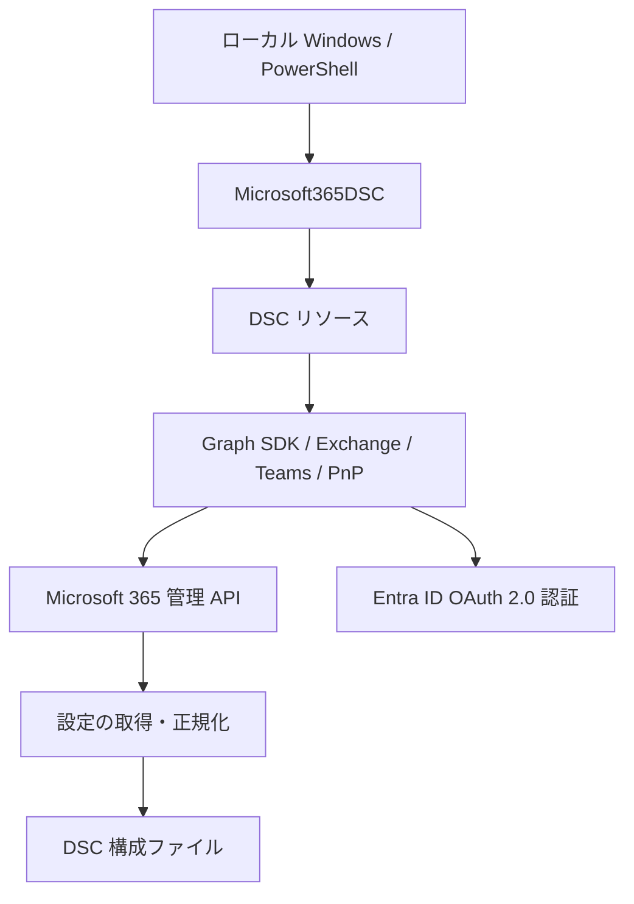
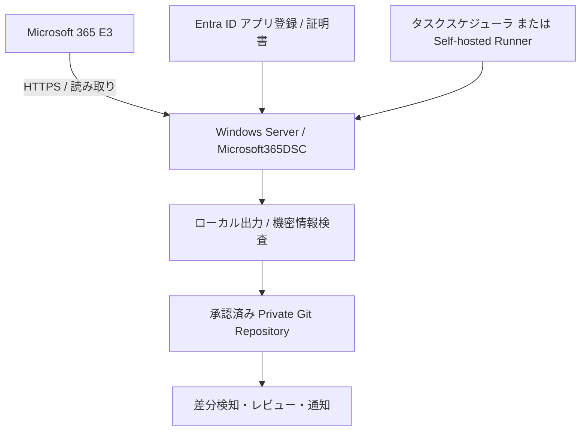
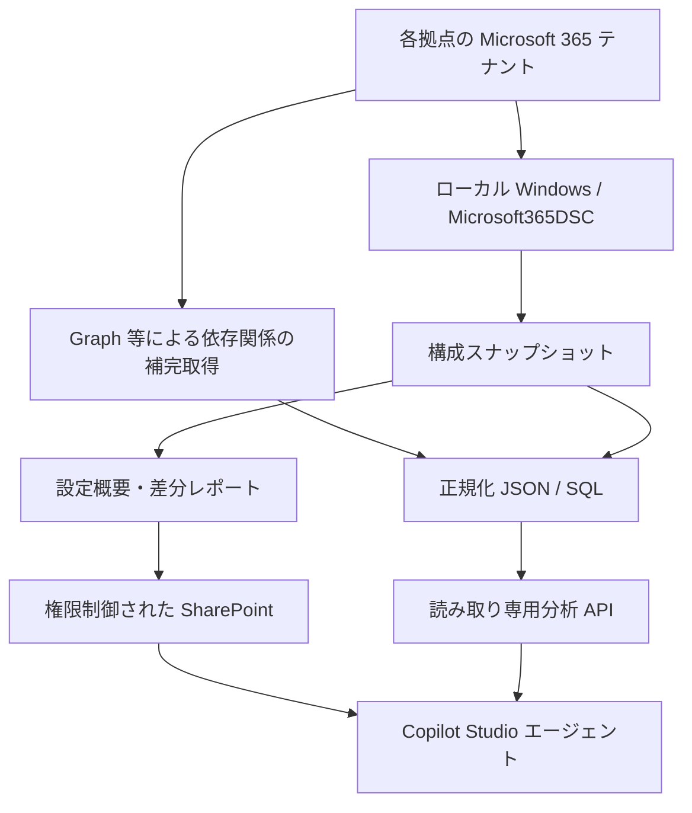

# Microsoft365DSC 導入・構成管理資料

## 1. 目的
Microsoft 365 E3 の設定を収集・構造化し、Copilot Studio エージェントによる設定変更の影響度推定、他拠点の設定調査・比較を実現する。棚卸し、変更履歴、構成ドリフト検知はそのための基盤とする。復元・展開は将来的な選択肢とする。

## 2. Microsoft365DSC とは
Microsoft 365 向けの Desired State Configuration (DSC) リソースを提供する OSS。MIT ライセンスで商用・社内利用が可能。再配布時には著作権・ライセンス表記を保持する。依存モジュールのライセンスは別途確認する。Microsoft の正式な製品サポートとは区別する。

## 3. 前提条件
- Microsoft 365 E3（Entra ID P1 を含む）。Office 365 E3 とは区別する。
- Windows PC または Windows Server、導入バージョンが要求する PowerShell / DSC 実行環境。
- Microsoft の認証・管理 API への HTTPS 通信。通常、受信ポートの開放は不要。
- 対象サービスのライセンス、API 権限、管理ロール。
- 専用 Azure VM や追加の Azure 契約は原則不要。

E3 でも利用可能だが、E5 固有の機能は対象外となる場合がある。Teams は契約内容に依存する。

## 4. 内部構造



各リソースは Get-TargetResource（取得）、Test-TargetResource（比較）、Set-TargetResource（適用）、Export-TargetResource（エクスポート）などを実装する。サービスごとに必要なトークンや権限は異なる。

## 5. 取得対象

| サービス | 主な設定 | 注意点 |
|---|---|---|
| Entra ID | 条件付きアクセス、認証、ユーザー、グループ、アプリ | P2 固有機能は別途契約 |
| Exchange | 組織設定、メールフロールール | メール本文は対象外 |
| SharePoint / OneDrive | 共有、サイト、テナント設定 | ファイル内容は対象外 |
| Teams | 会議、外部アクセス等のポリシー | 契約に依存 |
| Intune | 構成・準拠ポリシー | 追加機能は契約に依存 |
| Purview | DLP、保持等 | ライセンス・権限に依存 |

すべての設定が取得できるわけではない。対応リソース一覧と実際の取得結果を確認する。

## 6. 初期導入と手動エクスポート

導入前に公式ドキュメントで対象リリースの PowerShell 要件を確認する。以下はコマンド例であり、実テナントで未検証。

```powershell
Install-Module Microsoft365DSC -Scope CurrentUser -Force
Update-M365DSCDependencies
Set-M365DSCTelemetryOption -Enabled $false
Get-Command Export-M365DSCConfiguration -Syntax
Export-M365DSCConfiguration -LaunchWebUI
```

Export Generator で対象リソースと認証方式を選び、生成されたコマンドをローカルで実行する。MFA がある環境では対応する対話認証または証明書認証を選ぶ。最初は Entra ID の少数リソースから検証する。

取得対象の例：AADConditionalAccessPolicy、AADTenantDetails。必要権限は次のコマンドで確認する。

```powershell
Get-M365DSCCompiledPermissionList -ResourceNameList @(
    'AADTenantDetails',
    'AADConditionalAccessPolicy'
)
```

出力された Read / Update 権限を区別し、取得専用アプリには必要な読み取り権限のみを付与する。サービス固有の管理ロールも確認する。

## 7. 定期取得の推奨構成



- 取得専用の Entra ID アプリ登録と証明書認証を使用する。リソースごとのアプリ認証対応を確認する。
- 毎日1回の実行を初期案とする。頻度は運用要件に合わせて決定する。
- 証明書秘密鍵は OS の証明書ストア等で保護し、有効期限と更新を管理する。
- Git への保存は社内規程に従い、機密情報を検査してから実施する。
- API エラー、権限不足、取得件数、終了状態を記録し、部分取得を正常な設定削除と誤認しない。
- 出力の順序や揮発性プロパティによる不要な差分を抑える。モジュールバージョンを固定・記録する。

## 8. 環境再構築と構成適用

DSC 構成ファイルを利用して、対応する設定を別テナントへ適用できる。ただし、完全なテナント複製ではない。

1. 既存テナントから設定を取得する。
2. テナント ID、ドメイン、ユーザー・グループ ID、アプリ ID などを移行先に合わせる。
3. ライセンス、依存関係、対象リソースの適用可否を確認する。
4. 検証テナントで構成をコンパイル・比較し、対応する DSC 実行方式で適用する。
5. 再取得して期待する設定と比較する。
6. 本番適用は別の更新専用 ID、承認、変更計画、復旧手順を用意して実施する。

ユーザーパスワード、メール本文、ファイル内容、チャット履歴、秘密鍵、テナント契約自体はこの方法による完全復元の対象外。設定の復旧もリソースの対応状況に依存する。条件付きアクセス変更では管理者のロックアウト対策を必須とする。

## 9. 導入ステップ

| フェーズ | 実施内容 | 完了条件 |
|---|---|---|
| PoC | ローカルで Entra ID の少数設定を取得 | 管理画面と取得結果が一致 |
| 棚卸し | 対象サービスを拡大 | 取得成功・失敗・対象外を一覧化 |
| 自動化 | 証明書認証、定期実行、Git 差分 | 無人取得と異常通知を確認 |
| 構成管理 | 検証環境で適用・比較 | 変更結果と復旧手順を確認 |
| 本番展開 | 承認付き変更管理 | 権限分離・監査証跡を確保 |

## 10. セキュリティと制約
- 取得処理はローカルで動作するが、Microsoft のクラウド API との通信が必要。
- テレメトリ無効化だけで全依存モジュールの外部通信がなくなるとは限らない。
- 管理者権限の常用を避け、取得と適用の ID を分離する。
- Git の非公開設定だけに依存せず、アクセス制御、秘密情報検査、保持期間を定義する。
- 設定スナップショットは Microsoft 365 のデータバックアップの代替ではない。

## 11. 参考情報
- 公式プロジェクト: https://microsoft365dsc.com/
- ソースコード・ライセンス: https://github.com/microsoft/Microsoft365DSC
- Export Generator: https://export.microsoft365dsc.com/
- Microsoft Graph PowerShell: https://learn.microsoft.com/powershell/microsoftgraph/overview

## 12. 未確認事項
本資料は導入検討用。最新リリースの動作要件、個別リソースの対応状況、ライセンス原文、実テナントでの認証・取得・適用は未検証。毎日取得、Windows Server、Git 管理は推奨構成として仮定しており、確定要件ではない。

## 12. 主目的の再定義：Copilot Studio による設定調査・変更影響分析

本プロジェクトの主目的はバックアップや復元ではなく、設定変更前の影響度の推定と、他拠点の設定の調査・比較である。構成履歴はその根拠として利用する。初期段階では読み取り専用とし、エージェントによる設定変更は行わない。

### 推奨構成



- Microsoft365DSC：設定取得。DSC の出力を実行せず、構文解析して正規化する。
- Graph 等：ユーザー、グループ所属（必要に応じて推移的所属）、アプリ、ポリシー割当等を補完する。
- SharePoint：設定概要、拠点別レポート、変更履歴をナレッジとして公開する。
- 分析 API：参照関係、対象ユーザー数、拠点間差分を決定的なロジックで算出する。Copilot Studio のツールとして呼び出す。オンプレ API 接続方式、ゲートウェイやコネクタの対応、認証、ライセンスは別途検証する。
- Copilot Studio：自然言語の質問を解釈し、検索結果と分析 API の結果を根拠付きで説明する。

### データモデル案

| エンティティ | 主な属性 |
|---|---|
| Tenant / Site | tenantId、拠点コード、拠点判定ルール |
| Snapshot | snapshotId、tenantId、取得日時、取得成功・失敗・未対応の状態 |
| Resource | snapshotId、resourceType、resourceId、設定 JSON |
| Relationship | sourceId、targetId、関係種別、取得根拠 |
| Change | 変更前後の snapshotId、対象、変更プロパティ |

ID はテナント単位で管理する。異なるテナントの同等ポリシーは名称だけで同一とみなさず、明示的な対応表と設定内容で比較する。同一テナント内の拠点はグループや属性等で識別し、テナント共通設定と拠点固有の割当を区別する。

### 影響分析の例

条件付きアクセスポリシーの対象グループ変更を想定し、変更前後の対象集合を比較する。対象グループ、除外グループ、全ユーザー指定、対象アプリ、条件、ポリシー状態を確認する。重複ユーザーは除外し、他ポリシーとの重なりも提示する。対象候補人数と実際にアクセスが拒否される人数は区別する。端末状態、サインイン状況、動的グループの更新等により結果は変わるため、Entra の What If やレポート専用モード、サインインログによる検証を併用する。

回答には影響候補、人数、関連設定、拠点、取得日時、根拠リソース、未取得情報、確信度（確認済み・推定・判定不能）を含める。取得失敗を設定なしとして扱わない。影響度の初期分類は、認証不能や全社影響の可能性を高、部門・拠点単位の影響を中、限定的な影響を低とする暫定案とし、情報不足は判定不能とする。

### 段階的な PoC

1. Entra ID の条件付きアクセス、グループ、アプリの設定を読み取り専用で取得する。
2. 設定を正規化し、拠点別の Markdown レポートを SharePoint に格納する。
3. Copilot Studio で設定調査・拠点比較を実装する。
4. 分析 API で対象集合の比較と依存関係検索を実装する。
5. 管理者が既知の変更シナリオで結果を検証し、誤判定や未取得項目を記録する。
6. Exchange、SharePoint、Teams、Intune へ対象を拡張する。

### セキュリティ・未確定事項

取得用アプリとエージェントの実行権限を分離し、書き込み権限を与えない。拠点別の閲覧権限を SharePoint と分析 API の双方で強制する。設定ファイルの機密情報・個人情報は必要最小限とし、秘密情報をナレッジに登録しない。Copilot Studio の利用料金・容量・コネクタ要件は Microsoft 365 E3 とは別に確認する。各拠点が同一テナントか別テナントか、拠点識別属性、取得頻度、データ保存先、API の接続方式は未確定。実テナントでの取得および影響分析の精度は未検証。

参考：
- https://learn.microsoft.com/ja-jp/microsoft-copilot-studio/
- https://learn.microsoft.com/ja-jp/entra/identity/conditional-access/what-if-tool
- https://microsoft365dsc.com/
